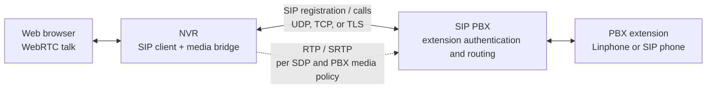
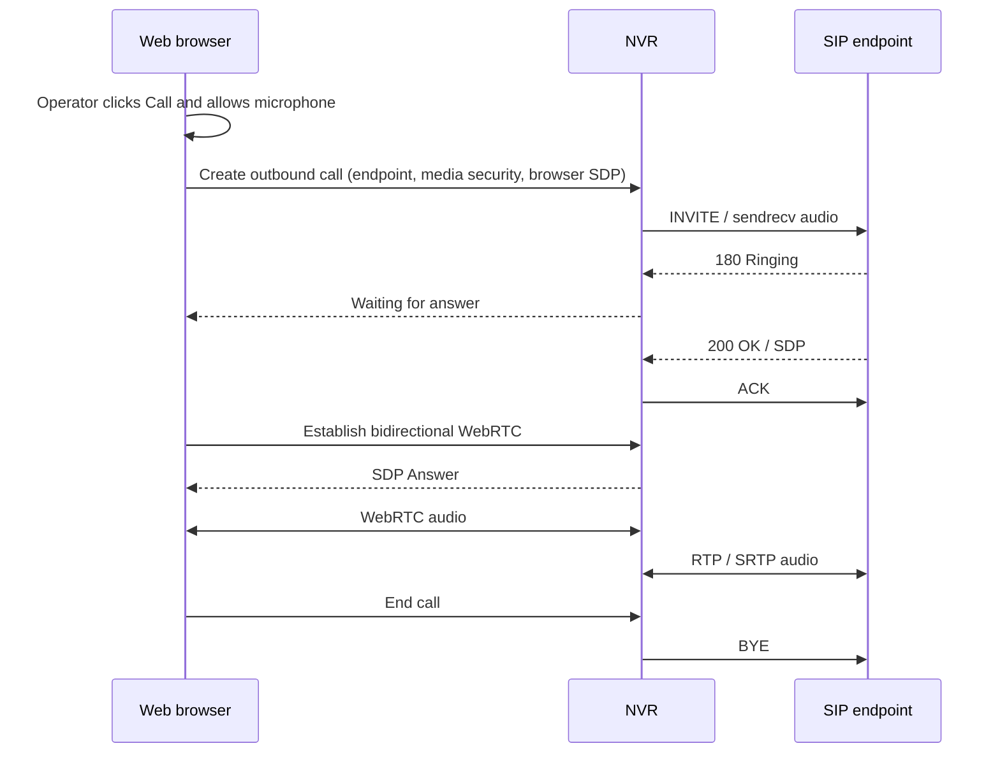
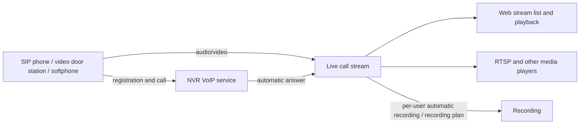

# VoIP Calling and Intercom

VoIP accepts calls from SIP phones, softphones, and video door stations. The Web UI can also place calls to registered endpoints or extensions on an upstream PBX and provide two-way audio. Calls to the NVR are answered automatically by default and published as live streams; operators can enable manual answering in the Web UI. Streams can be viewed in the Web UI or played through RTSP and other supported protocols.

Typical uses include video door entry, aggregating audio/video from SIP endpoints, and sending audio/video from softphones such as Linphone to the NVR. VoIP runs its own SIP service on port **5070** by default, so it can run alongside the GB28181 service on **5060**.

## Features

| Feature | Description |
|---------|-------------|
| Web two-way talk | Join an answered call with the browser microphone, or call an endpoint from the Web UI. Includes mute, DTMF keypad, leave-talk, and hang-up controls. |
| Inbound call answering | Automatically answer calls by default, or let an operator answer or reject them in the Web UI with a configurable ring timeout. |
| SIP PBX | Register the NVR to an upstream PBX over UDP, TCP, or TLS and call PBX extensions from the Web UI. |
| Web configuration | Enable the service, configure addresses, and manage SIP users in Settings. Changes take effect when saved. |
| Authentication | SIP Digest authentication with SIP credentials separate from NVR Web accounts. |
| Call management | View registered endpoints and active calls, including duration and codecs; hang up an individual call. |
| Automatic recording | Enable recording per SIP user; each call is saved separately as audio or audio/video. |
| Media changes | Support hold/resume, adding video during a call, and SDP-bearing re-INVITE/UPDATE requests. |
| Live playback | Each call creates a stream in the NVR stream list and media distribution pipeline. |
| Transports | UDP, TCP, TLS, WS, and WSS; experimental DTLS signaling is also available. |
| Media encryption | SDES-SRTP and DTLS-SRTP, with an option to require encrypted media. |

VoIP requires the embedded media mode (`media.mode: embedded`), which is the default. Inbound calls receive audio/video and can be joined from the Web UI for two-way talk after answering. Web-initiated calls also support two-way talk. The browser communicates with the NVR over WebRTC.

## What is a PBX?

A PBX (Private Branch Exchange) is an enterprise phone system that handles call control. A SIP PBX usually manages extension accounts and registration, receives calls, and routes them to extensions; it may also provide dial plans, IVR menus, and ring groups. Asterisk and FreePBX are common self-hosted PBX options. Linphone is a SIP softphone that can act as an extension of a PBX; it is not itself a PBX.

In this setup, the NVR is a SIP client of the PBX. It registers with an account provided by the PBX. A Web operator enters an extension, and the NVR sends the SIP call through the PBX, which routes it to that extension. The browser does not register with the PBX; it establishes a WebRTC talk session with the NVR. Audio travels from the NVR to the media address negotiated in SDP. Whether the PBX relays media or the endpoint sends it directly depends on the PBX media-routing configuration.



## Manually answer inbound SIP calls

Calls are answered automatically with the default configuration. To have an operator decide whether to answer, enable **Require Web operator to answer incoming calls** on the VoIP page and set the ring timeout. On an incoming call, the endpoint receives `180 Ringing` and the Web call list shows **Answer** and **Reject** actions. The NVR establishes media and publishes a live stream only after the operator answers. Rejecting returns SIP `603 Decline`; a timeout returns `480 Temporarily Unavailable`; if the caller cancels first, the NVR ends the call with `487 Request Terminated`.

## Register to an upstream SIP PBX

Under **Register to upstream SIP PBX** on the VoIP page, enter the PBX address (`host:port`), choose UDP, TCP, or TLS, and provide the account and password. The NVR supports Digest `401/407` authentication and renews successful registrations before they expire. If a TCP/TLS connection drops, it reconnects and registers again. The page shows registration state, transport, and expiry time. Change the PBX account or clear the server address to switch or disable registration. The PBX password is never displayed; leave it blank to keep the current password.

When registration is **Registered**, enter an extension in the status panel and click **Call**. The NVR sends an `INVITE` to the PBX over the selected transport; browser-to-NVR two-way audio still uses WebRTC. TLS verifies the PBX certificate using system-trusted CAs by default. For a private CA, provide its certificate file path. If the PBX is addressed by IP but its certificate is issued to a hostname, set the TLS Server Name. The upstream PBX transport is independent of the listener configuration for inbound endpoints; configure UDP, TCP, TLS, WS, or WSS listeners separately as needed.

TCP and TLS describe the SIP signaling connection between the NVR and PBX. They do not automatically encrypt RTP audio. TLS protects signaling; media encryption is negotiated separately through SRTP in SIP/SDP. Also check PBX call routing, NAT/media addresses, and RTP firewall rules so the NVR and media peer can reach each other.

### Interoperability test with a real PBX

A temporary Asterisk 22 (PJSIP) PBX was used for protocol-level interoperability testing. Registration authentication and NVR-initiated calls were verified: the NVR registered over UDP, TCP, and TLS; a TLS call passed Digest authentication; Asterisk routed it to a test extension running the Echo application; the NVR received `200 OK`, sent `ACK`, and released the Asterisk channel after hang-up. Testing found and fixed a TLS outbound-call issue where `sips:` addresses were not handled correctly when constructing Via/From headers. This verifies registration, authentication, call setup, and release. End-to-end two-way WebRTC/RTP audio through a browser microphone still needs validation in an environment with browser audio input. For a deployment, verify UDP, TCP, and TLS against the PBX version and certificate configuration. See the [Asterisk PJSIP transport configuration](https://docs.asterisk.org/Asterisk_20_Documentation/API_Documentation/Module_Configuration/res_pjsip/) for transport options.

## Call an endpoint or PBX extension from the Web UI

1. Enable VoIP on the **VoIP Intercom** page and register a SIP endpoint with the NVR.
2. In the online endpoint list, choose the media security mode and click **Call** for the endpoint.
3. Allow microphone access the first time the browser asks. Answer the ringing call on the endpoint.
4. When the page shows that audio is connected, both sides can talk. You can mute the browser microphone. If the browser blocks audio playback, click **Play remote audio**.
5. Click **Hang up** to end the call, or cancel the call while it is ringing. If the endpoint hangs up, the browser microphone is released automatically.

The page must be opened over HTTPS or localhost to use the microphone. The endpoint's media-encryption setting must match its configuration. **Use server setting** uses DTLS-SRTP when SRTP is mandatory and RTP otherwise; SDES-SRTP and DTLS-SRTP can also be selected explicitly.

The browser sends and receives audio over one WebRTC connection. The NVR bridges it to RTP/SRTP for the endpoint. Web talk supports **Opus, G.711 A-law (PCMA), and G.711 μ-law (PCMU)**. It uses a codec supported by both sides and does not transcode audio. AAC is supported for inbound calls but is not used for Web two-way talk.



Each endpoint can have one Web-initiated call at a time, and each call can have one browser attached. Closing the page or navigating away hangs up the call. If the page disconnects unexpectedly, the server ends it after at most 45 seconds without a talk heartbeat. The browser uses lalmax's WebRTC advertised address and ICE listener (port `4888` by default); the endpoint continues to use the VoIP media port range. For deployments across networks, configure the addresses and ports for both paths.

Audio sent by the endpoint during an outbound call appears in the stream list. If automatic recording is enabled for that SIP user, the endpoint's audio can be recorded. The browser microphone is not mixed into that recording. During a call, mute other players to avoid hearing the endpoint twice.

## Join an inbound endpoint call

After an endpoint calls in, the NVR answers automatically and publishes a live stream. In **VoIP Intercom → Endpoints and Calls**, click **Join talk** on the inbound call and allow microphone access to talk with the endpoint. Only one browser can join each SIP call.

Click **Leave talk** or close the page to release the browser microphone and WebRTC session while keeping the SIP call and live stream active. Click **Hang up** on the call row to end the SIP call. If the page disconnects unexpectedly, the NVR releases the browser session after 45 seconds without a talk heartbeat, but the SIP call stays connected. If the endpoint hangs up or SIP media is renegotiated, browser talk disconnects; rejoin while the call is still active.

After Web talk is established, a keypad is available. Clicking a key sends RFC 4733 `telephone-event` to the SIP endpoint, for use with door-entry menus and IVR. It is available only if the endpoint negotiated `telephone-event` in SDP. For outbound calls, the NVR offers this capability in the INVITE; for inbound calls, support is determined by the endpoint's SDP.

## How calls become NVR streams

1. The endpoint registers with a SIP user configured in the NVR.
2. The endpoint calls the NVR with audio or video.
3. The NVR answers automatically and negotiates codecs and media transport.
4. The endpoint sends audio/video, and a **VoIP Call** stream appears in the NVR stream list.
5. View the stream. When the endpoint hangs up, the stream goes offline and the call's media ports are released.



Registration and calling are separate actions. Registration alone does not create a stream; the endpoint must place a call. Hanging up does not unregister the account, so the endpoint can call again.

## Enable VoIP in the Web UI

For an NVR at `192.168.1.20` and SIP user `door01`:

1. Open the **VoIP Intercom** page and enable **VoIP**.
2. Set the listener address, SIP advertised IP, media advertised IP, and media port range.
3. Enable **User authentication**, add `door01`, and set its password.
4. Click **Save** at the bottom of the page.

For a LAN deployment, use values like these:

| Form field | Example | Purpose |
|------------|---------|---------|
| SIP UDP listen address | `0.0.0.0:5070` | Receive endpoint UDP registration and calls |
| SIP TCP listen address (optional) | `0.0.0.0:5070` | Set to enable TCP; leave blank to disable |
| SIP advertised IP | `192.168.1.20` | Address endpoints use to reach the NVR SIP service |
| Media advertised IP | `192.168.1.20` | Address to which endpoints send audio/video |
| Media UDP port start/end | `41000` / `42000` | Media ports allocated to concurrent calls |
| SIP authentication realm | `lalmax-nvr` | Digest authentication realm; usually keep the default |

The **listen address** can use `0.0.0.0` to listen on all local interfaces. The **advertised IP** must be an IPv4 address reachable by endpoints; it cannot be `0.0.0.0`, and remote endpoints cannot use `127.0.0.1`.

Changes take effect immediately without restarting the NVR. Changing the configuration or disabling the service ends active VoIP calls. If the new configuration fails to start or save, the NVR restores the previous configuration. User passwords are not shown. Leave an existing user's password blank to keep it; adding or renaming a user requires a password.

## Configure a SIP endpoint

Configure these values on the phone, door station, or softphone. Field names vary by endpoint:

| Endpoint setting | Example |
|------------------|---------|
| SIP server / domain | `192.168.1.20` |
| SIP port | `5070` |
| Username / authentication username | `door01` |
| Password | The password configured for `door01` in the NVR |
| Transport | UDP, matching an enabled NVR listener |
| Call target | `sip:1@192.168.1.20:5070;transport=udp` |

Replace `1` in the call target with any number. The NVR currently answers inbound calls uniformly and does not route them to extensions based on the called number. SIP users are separate from NVR Web accounts.

### Linphone example

1. Add a third-party SIP account using the server, username, and password above.
2. Set the Registrar URI to `sip:192.168.1.20:5070;transport=udp`.
3. Choose Opus or G.711 for audio and H.264 for video.
4. Call `sip:1@192.168.1.20:5070;transport=udp`. Choose a regular call for audio only or a **video call** for audio and video.
5. Open the corresponding VoIP stream in the NVR stream list.

For TCP, first enable the TCP listener on the VoIP page, then change `transport=udp` to `transport=tcp` in the Registrar URI and call target. For DTLS-SRTP, enable SRTP in the page's advanced options and select the matching media encryption mode on the endpoint.

Endpoints can use SDP to hold/resume a call or enable the camera during a call. The NVR updates received media using re-INVITE/UPDATE. The stream name stays the same; after adding or changing a media track, reopen the player to obtain the updated audio/video information. The endpoint must include SDP in the renegotiation request; delayed offers without SDP are not supported.

## View and manage calls

In **Endpoints and Calls** on the **VoIP Intercom** page, view each registered endpoint's account, client, source address, transport, and registration expiry. Active calls show caller/callee, state, duration, and codecs. The status refreshes every five seconds and can also be refreshed manually.

Click the caller or callee of an active call to open its stream. Click **Hang up** to end that call without affecting other calls or unregistering the endpoint. Hanging up requires operator permission. The NVR keeps one registration record per SIP user; a new registration from the same account updates the existing record.

When a call ends, its details are saved in the local SQLite call history: direction, caller/callee, result, start and answer times, duration, transport, media codecs, and failure reason. Results include answered, unanswered, rejected, cancelled, and failed. The Web UI sorts by end time, newest first, and shows 20 records per page. Records remain in the NVR database after a service restart. If a record has a related live stream, open it from the history entry.

## Playback and recording

After a call is answered, the stream list shows a live stream with source **VoIP Call**. Stream names use this format:

```text
voip_<caller_username>_<call_id>
```

For example: `voip_door01_abc123def456`. Each call uses its Call-ID to form the stream name, so calls from the same user usually have different names.

Open the stream details to see media information and playback URLs. You can also use RTSP:

```text
rtsp://192.168.1.20:15544/live/voip_door01_abc123def456
```

The playback port depends on the deployment; use the URL shown in the stream details. Audio-only calls also create live streams. Browser playback depends on the selected output protocol and browser codec support; use an RTSP player that supports the negotiated codec if needed.

To record future calls from a SIP user automatically, select **Automatically record this user's calls** next to the user and save. Automatic recording requires user authentication. Calls are not recorded automatically just because VoIP is enabled or a call is answered.

Each call is saved as a separate MP4. The current segment is finalized when the call ends and can be viewed in recording playback under its stream. Audio/video and audio-only AAC, G.711, and Opus recordings are supported. No new media is written while a call is on hold; recording resumes after media resumes or changes. Browser playback depends on codec support; download G.711 files and use a compatible player.

Without per-user automatic recording, you can use an NVR [recording plan](recording-plans.md). A plan is bound to a specific `stream_id` and does not automatically apply to a new call from the same user.

## Codecs and transports

Supported media codecs:

| Type | Codecs |
|------|--------|
| Audio | Opus, MPEG4-GENERIC AAC, PCMA/8000, PCMU/8000 |
| Video | H.264, H.265 |
| Key events | telephone-event DTMF; events can be parsed and logged |

AAC endpoints must include an AudioSpecificConfig (the `config` parameter in SDP `fmtp`). The NVR receives and distributes media using the negotiated codec and does not transcode automatically. Choose codecs with the endpoint, player, and recording requirements in mind.

### Advanced transport and media security

Expand **Advanced Transport and Media Security** in the Web UI to configure additional signaling listeners and media encryption:

| Signaling | Configuration field | Example |
|-----------|---------------------|---------|
| UDP | `sip_listen_addr` | `sip:192.168.1.20:5070;transport=udp` |
| TCP | `sip_tcp_listen_addr` | `sip:192.168.1.20:5070;transport=tcp` |
| TLS | `sip_tls_listen_addr` | `sip:192.168.1.20:5061;transport=tls` |
| WS | `sip_ws_listen_addr` | `ws://192.168.1.20:8088/` |
| WSS | `sip_wss_listen_addr` | `wss://192.168.1.20:8443/` |
| DTLS (experimental) | `sip_dtls_listen_addr` | Requires an endpoint that supports DTLS-UDP signaling |

Only UDP uses port `5070` by default. Other listeners must be configured explicitly; the ports above are examples. TLS, WSS, and DTLS signaling require certificate and private key paths on the server, and endpoints must trust the certificate. WS/WSS use the `sip` subprotocol and listen independently of the Web management page.

**Signaling transport and media transport are configured separately.** With TCP, TLS, or WebSocket, audio/video still travels over UDP. TLS/WSS protects SIP signaling; SRTP protects audio/video.

- **Enable SRTP media encryption**: allow endpoints to negotiate SDES-SRTP or DTLS-SRTP.
- **Require SRTP media encryption**: reject cleartext media; SRTP must also be enabled.
- **Bundle audio and video**: allow DTLS-SRTP endpoints that support it to share audio/video ports.

### Network and ports

Endpoints need access to both the SIP listener and the media UDP port range. Behind NAT, set the advertised IP to an address reachable by endpoints and forward the relevant SIP port and the full media port range.

Without RTCP multiplexing, each media stream uses an RTP/RTCP port pair, so an audio/video call may use multiple pairs. The size of the port range limits concurrent calls. The NVR supports RTCP receiver reports and can request a video keyframe when the endpoint supports PLI.

## YAML configuration

For file-based deployment, add a configuration like this and restart the NVR after editing YAML:

```yaml
media:
  mode: embedded
voip:
  enabled: true
  manual_answer: false
  ring_timeout_ms: 30000
  sip_listen_addr: "0.0.0.0:5070"
  sip_tcp_listen_addr: "0.0.0.0:5070"
  sip_ip: "192.168.1.20"
  media_ip: "192.168.1.20"
  media_port_min: 41000
  media_port_max: 42000
  realm: "lalmax-nvr"
  auth_enable: true
  users:
    - username: "door01"
      password: "replace-with-your-password"
      record_calls: true
  # Optional upstream PBX registration. PBX account can call Web extensions.
  pbx_server: "pbx.example.com:5060"
  pbx_transport: udp          # udp | tcp | tls
  pbx_domain: "example.com"
  pbx_tls_server_name: ""    # optional TLS certificate name override
  pbx_tls_ca_file: ""        # optional private CA PEM; empty uses system roots
  pbx_username: "nvr-account"
  pbx_password: "replace-with-pbx-password"
  pbx_register_expires: 3600
```

Common options:

| Option | Default | Description |
|--------|---------|-------------|
| `enabled` | `false` | Enable the VoIP service |
| `manual_answer` | `false` | Have a Web operator answer inbound calls; calls are answered automatically by default |
| `ring_timeout_ms` | `30000` | Time to wait for an operator in manual-answer mode |
| `pbx_server` | empty | Upstream SIP PBX address in `host:port` format |
| `pbx_transport` | `udp` | Upstream signaling transport: `udp`, `tcp`, or `tls` |
| `pbx_domain` | PBX host | Domain used for SIP registration and extension addresses |
| `pbx_tls_server_name` | PBX address hostname | Override the TLS certificate hostname; used only with TLS |
| `pbx_tls_ca_file` | System CA | Private CA PEM file path; used only with TLS |
| `pbx_username` / `pbx_password` | empty | Upstream PBX credentials |
| `pbx_register_expires` | `3600` | PBX registration lifetime in seconds |
| `rtp_timeout_ms` | `15000` | End a connected call after this long without valid media |
| `ack_timeout_ms` | `32000` | Maximum time in milliseconds to wait for endpoint confirmation after answering |
| `srtp_enable` | `false` | Allow SRTP media encryption |
| `srtp_mandatory` | `false` | Accept only SRTP-encrypted media |
| `bundle_enable` | `false` | Allow DTLS-SRTP audio/video port sharing |
| `sip_tls_cert_file` / `sip_tls_key_file` | empty | Certificate and private key for encrypted signaling listeners |

See the full [configuration example](../../config/config.example.yaml).

## API integration

- `GET /api/settings/voip`: read configuration; user passwords are omitted.
- `PUT /api/settings/voip`: save and apply configuration. A user's `record_calls` field controls automatic recording.
- `GET /api/voip/status`: list registered endpoints and active calls.
- `GET /api/voip/calls/history?limit=20&offset=0`: page through ended calls. Returns `items`, `total`, `limit`, and `offset`; `limit` must be 1–100.
- `POST /api/voip/calls`: create an outbound call with `{ "user": "1001", "security": "dtls", "sdp": "browser SDP offer" }`. Returns `call_id`, `state`, and a private `talk_token`. `security` is optional and accepts `rtp`, `sdes`, or `dtls`.
- `POST /api/voip/calls/{call_id}/talk`: after the endpoint answers, submit `{ "talk_token": "token returned at creation", "sdp": "browser SDP offer" }` to receive a WebRTC SDP answer.
- `POST /api/voip/calls/{call_id}/talk-token`: request a 30-second Web talk token for an answered inbound audio call; requires operator permission.
- `POST /api/voip/calls/{call_id}/talk/detach`: submit `{ "talk_token": "talk token" }` to leave browser talk while keeping the SIP call active.
- `POST /api/voip/calls/{call_id}/keepalive`: submit `{ "talk_token": "token returned at creation" }` every 10 seconds to keep the browser session alive.
- `POST /api/voip/calls/{call_id}/dtmf`: send `{ "digit": "5" }`. Valid digits are `0`–`9`, `*`, and `#`; the SIP peer must negotiate RFC 4733 `telephone-event`.
- `POST /api/voip/calls/{call_id}/hangup`: cancel an outbound call while ringing or hang up an answered call.
- `POST /api/voip/calls/{call_id}/answer`: answer an inbound SIP call waiting for an operator; requires operator permission.
- `POST /api/voip/calls/{call_id}/reject`: reject an inbound SIP call waiting for an operator; requires operator permission.

These endpoints use the NVR's authentication and permission controls. Write operations require operator permission.

## Scope and troubleshooting

VoIP currently supports standard inbound SIP calls with automatic answering and Web two-way audio for calls placed to registered endpoints. Outbound calls do not currently support sending video, hold/resume or media renegotiation, call transfer, dialing arbitrary SIP URIs, or PBX account management. If an endpoint requests a media change during an outbound call, the server rejects the change and keeps the existing call. Session-Timer, AV1, ZRTP, and IPv6 are not supported. WS/WSS carry SIP signaling; media does not use ICE/STUN/TURN negotiation. The browser uses WebRTC through the NVR talk API and does not register directly with the SIP WS/WSS service.

| Symptom | What to check |
|---------|---------------|
| Registration fails | Check server address, listener port, transport, and SIP username/password. An initial `401` is a normal authentication challenge. |
| Registered, but no stream appears | Registration does not create a stream; place a call, then check codecs, advertised IP, and media-port reachability. |
| Call ends soon after connecting | Check endpoint confirmation and media arrival, or whether someone changed the VoIP configuration. |
| Stream exists, but audio/video will not play | Check player codec support and try the RTSP URL from stream details; the NVR does not transcode automatically. |
| Encrypted connection fails | Check certificate path, validity, endpoint trust, and whether media-encryption settings match on both sides. |
| No more calls can be accepted | Check available media ports and expand the range if needed; update firewall and NAT mappings too. |
